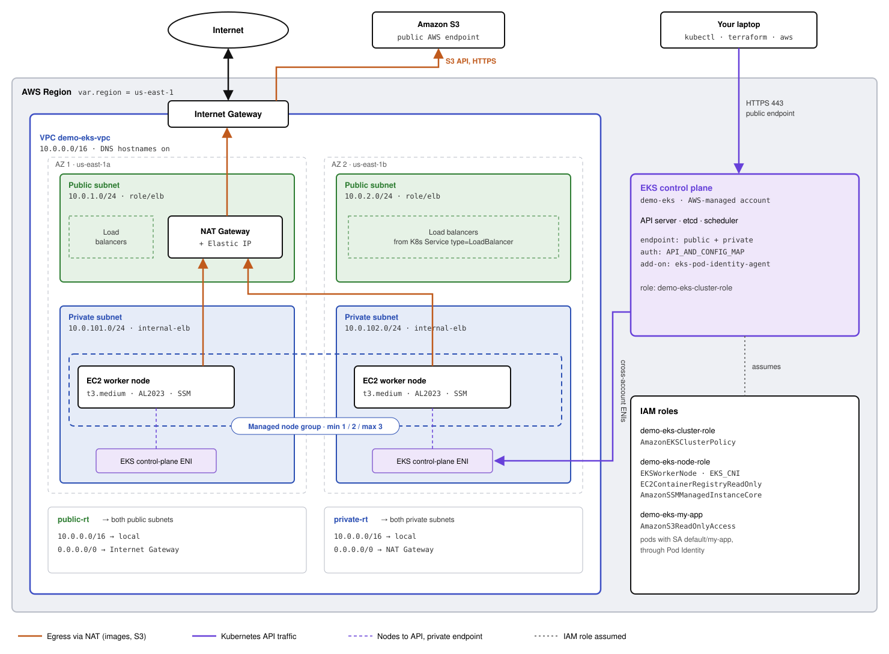

# EKS Practice: VPC, Pod Identity, Topology Spread, Probes and HPA

Terraform builds an EKS cluster in its own VPC. A sample Kubernetes app runs on it and uses
**EKS Pod Identity** to read from Amazon S3. The app is spread across Availability Zones,
health-checked with probes, and autoscaled by an HPA.

## Architecture



The editable source is [docs/architecture.drawio](docs/architecture.drawio). Open it in
[draw.io](https://app.diagrams.net) or the VS Code Draw.io Integration extension.

| Layer | What's built | File |
|---|---|---|
| Network | VPC `10.0.0.0/16` with 2 AZs. Each AZ has 1 public subnet (`role/elb`) and 1 private subnet (`internal-elb`). One NAT Gateway with an Elastic IP sits in the first public subnet. | [vpc.tf](vpc.tf) |
| Routing | `public-rt` sends `0.0.0.0/0` to the Internet Gateway. `private-rt` sends `0.0.0.0/0` to the NAT Gateway. | [vpc.tf](vpc.tf) |
| Control plane | EKS cluster `demo-eks` with both public and private API endpoints and `API_AND_CONFIG_MAP` auth. Its ENIs are placed in all 4 subnets. | [eks.tf](eks.tf) |
| Workers | Managed node group of `t3.medium` nodes on AL2023 in the **private** subnets only (min 1, desired 2, max 3). SSM access is enabled. | [eks.tf](eks.tf) |
| IAM | `demo-eks-cluster-role` for the control plane. `demo-eks-node-role` for the nodes (WorkerNode, CNI, ECR read-only, SSM). `demo-eks-my-app` for the pods (S3 read-only). | [eks.tf](eks.tf) |
| Add-on | `eks-pod-identity-agent` | [eks.tf](eks.tf) |
| App | ServiceAccount, Deployment and HPA | [k8s/](k8s/) |

**Traffic paths**
- **Laptop to cluster:** `kubectl` reaches the **public** API endpoint over HTTPS 443.
- **Nodes to control plane:** nodes reach the API through the control-plane ENIs that EKS
  places inside the VPC (the **private** endpoint). They never leave the VPC.
- **Egress:** nodes in private subnets go through the NAT Gateway, then the Internet Gateway, to
  reach the internet. That covers image pulls and calls to S3, STS and EKS Auth. There are no VPC
  endpoints, so S3 traffic goes through NAT too.

---

## 1. Pod Identity: how the pod reaches S3 without stored keys

The pod has no access keys. It gets short-lived credentials for the IAM role
`demo-eks-my-app` because it runs as the `default/my-app` ServiceAccount.

```
Pod (SA default/my-app)
  │ 1. The AWS SDK/CLI sees env vars injected by EKS:
  │      AWS_CONTAINER_CREDENTIALS_FULL_URI=http://169.254.170.23/v1/credentials
  │      AWS_CONTAINER_AUTHORIZATION_TOKEN_FILE=<projected SA token>
  ▼
eks-pod-identity-agent (DaemonSet on every node, link-local 169.254.170.23)
  │ 2. Sends the pod's ServiceAccount token to the EKS Auth API
  │    (AssumeRoleForPodIdentity)
  ▼
EKS Auth API
  │ 3. Looks up the association: cluster demo-eks + ns default + SA my-app → demo-eks-my-app
  │    Assumes the role, adding session tags (cluster, namespace, SA, pod name...)
  ▼
Temporary credentials go back to the pod. The SDK refreshes them automatically.
  │ 4. aws s3 ls  →  NAT → IGW → S3 public endpoint
  ▼
Amazon S3 (AmazonS3ReadOnlyAccess)
```

Three things in Terraform make this work ([eks.tf](eks.tf)):

1. **Add-on:** `aws_eks_addon.pod_identity` installs the agent DaemonSet.
2. **Role trust policy:** it trusts `pods.eks.amazonaws.com` with `sts:AssumeRole` **and**
   `sts:TagSession`. The tag permission is needed because Pod Identity always adds session tags.
3. **Association:** `aws_eks_pod_identity_association` maps `default/my-app` to the role.

Unlike IRSA, Pod Identity needs **no OIDC provider** and **no annotation on the
ServiceAccount**. The role trust policy is generic, so it can be reused across clusters.

The app container loops every 60 seconds. Each pass prints the role it is running as
(`sts get-caller-identity` should show `assumed-role/demo-eks-my-app/...`) and lists the
S3 buckets. That shows Pod Identity working end to end.

---

## 2. Topology spread: staying up if an AZ fails

[k8s/my-app-deployment.yaml](k8s/my-app-deployment.yaml) has two rules:

| Rule | `topologyKey` | `whenUnsatisfiable` | Effect |
|---|---|---|---|
| Spread across AZs | `topology.kubernetes.io/zone` | `DoNotSchedule` (**hard**) | Pod counts per AZ may differ by at most 1. If a new pod would break that, it stays `Pending`. |
| Spread across nodes | `kubernetes.io/hostname` | `ScheduleAnyway` (**soft**) | The scheduler prefers different nodes, but still places the pod if it can't. |

With 2 replicas and 2 AZs, you get 1 pod per AZ, so losing a whole AZ still leaves 1 pod running.
The AZ rule matters more than the node rule, which is why only the AZ rule is hard.

---

## 3. Probes: startup, readiness and liveness

The container sleeps for 20 seconds to simulate a slow boot. Then it creates the files the probes check.

| Probe | Check | Timing | On failure |
|---|---|---|---|
| **startup** | `cat /tmp/started` | every 5s, 12 failures allowed (about 60s budget) | Container restarted. Readiness and liveness checks don't run until this passes. |
| **readiness** | `cat /tmp/ready` | every 5s, fails after 1 failure | Pod **removed from Service endpoints** (`READY 0/1`). **Not** restarted. |
| **liveness** | `cat /tmp/healthy` | every 10s, fails after 3 failures | Container **restarted** (`RESTARTS` +1). |

The startup probe protects slow-booting apps from being killed by liveness checks too early.
Readiness controls whether a pod gets traffic. Liveness restarts a container that is stuck.

---

## 4. HPA: autoscaling on CPU and memory

[k8s/my-app-hpa.yaml](k8s/my-app-hpa.yaml) (`autoscaling/v2`):

- Scales the `my-app` Deployment between **2 and 6** replicas.
- Scales out when average **CPU or memory** use reaches **70% of the pod's requests**
  (`cpu: 200m`, `memory: 128Mi`). The HPA computes a replica count for each metric and uses the larger one.
- `scaleDown.stabilizationWindowSeconds: 30` makes it wait 30 seconds after usage drops before
  it removes pods. That's shortened for the demo; the default is 300 seconds.
- `minReplicas: 2` keeps at least one pod per AZ, so the HPA works with the topology spread rule.
- **Needs metrics-server** in the cluster. Without it the HPA shows `<unknown>` targets.
- Utilization is a percentage of **requests**, so the HPA can't work unless requests are set.

Node capacity is a separate layer. The node group goes up to 3 nodes, but nothing adds nodes
automatically in this setup. If the HPA scales out past what the nodes can fit, the extra pods
stay `Pending` until you add a Cluster Autoscaler or Karpenter.

---

## Repo layout

```
.
├── providers.tf        # AWS provider
├── variables.tf        # region, CIDRs, cluster name, node sizing
├── vpc.tf              # VPC, subnets, IGW, NAT, route tables
├── eks.tf              # cluster, node group, IAM roles, Pod Identity
├── outputs.tf
├── k8s/
│   ├── my-app-deployment.yaml   # ServiceAccount + Deployment (topology spread, probes)
│   └── my-app-hpa.yaml          # HorizontalPodAutoscaler
├── python/
│   ├── config_check.py          # config validation exercise
│   └── README.md
└── docs/
    ├── architecture.drawio      # editable diagram source
    └── architecture.svg         # image shown above (GitHub renders it)
```

> **Cost note:** the NAT Gateway, the EKS control plane and the nodes are billed by the hour.
> Run `terraform destroy` when you're done.
